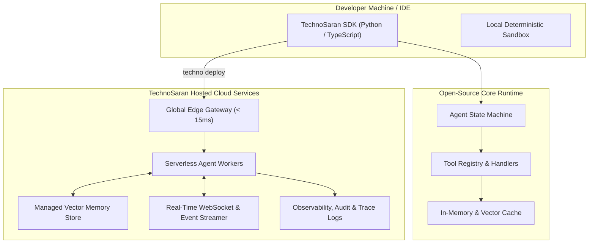

<div align="center">

# ⚡ TechnoSaran

### Open-Source AI Developer Platform & Hosted Cloud Services

An open-source AI developer tool building hosted cloud services, autonomous agent runtimes, and real-time financial intelligence pipelines.

[](https://opensource.org/licenses/MIT)
[](https://github.com/technosaran/technosaran.github.io/releases)
[](https://technosaran.me)
[](https://technosaran.me)

[**🌐 Live Landing Page & Cloud Portal**](https://technosaran.me) • [**📖 Documentation**](https://technosaran.me#docs) • [**☁️ Join Cloud Beta**](https://technosaran.me) • [**💬 Discord Community**](https://technosaran.me)

---

</div>

## 📌 Executive Summary & Positioning

**TechnoSaran** is an open-source AI developer platform and runtime designed to bridge local autonomous agent development with production-grade hosted cloud infrastructure. 

Developers can prototype complex multi-agent workflows locally with our lightweight, typed SDKs, and seamlessly deploy them to **TechnoSaran Managed Cloud**—a low-latency serverless edge environment equipped with persistent vector memory, automated WebSocket event pipelines, and enterprise security.

---

## 🌟 Key Pillars

- **🧠 Autonomous Agent Runtime**: Deterministic state machine execution, multi-tool chaining, structured JSON outputs, and automated fault recovery.
- **☁️ Hosted Developer Cloud**: Deploy agents to global serverless worker pools with zero Docker or Kubernetes maintenance.
- **📈 Real-Time Data Streaming**: Sub-millisecond WebSockets and event pipelines tailored for market data, trading signals, and IoT sensor streams.
- **🔐 Enterprise Security & RLS**: Built-in support for PostgreSQL Row-Level Security, secret vaults, and RBAC access tokens.
- **🔌 Pluggable Ecosystem**: Native adapters for Supabase, PostgreSQL (pgvector), TradingView, LangChain, and REST APIs.

---

## 🏗️ Architecture



---

## 🚀 Quickstart

### 1. Installation

Install via your preferred package manager:

```bash
# TypeScript / Node.js
npm install @technosaran/sdk

# Python
pip install technosaran-core
```

### 2. Quick Code Example (TypeScript)

```typescript
import { Agent, CloudRuntime } from '@technosaran/sdk';

// 1. Initialize connection to TechnoSaran Managed Cloud
const runtime = new CloudRuntime({
  apiKey: process.env.TECHNO_API_KEY,
  region: 'auto', // Dispatches to closest edge cluster
  edgeSync: true,
});

// 2. Define an autonomous market intelligence agent
const agent = runtime.createAgent({
  name: 'wealth-engine-agent',
  model: 'gemini-1.5-pro',
  tools: ['realtime_portfolio_sync', 'tax_loss_harvesting'],
  memory: {
    type: 'persistent_vector_store',
    retentionDays: 365,
  },
});

// 3. Deploy live with instant serverless cloud execution
await agent.deploy();
console.log('⚡ Agent online at https://api.technosaran.me/v1/agents/wealth-engine');
```

### 3. Quick Code Example (Python)

```python
from technosaran import Agent, CloudRuntime
import os

# 1. Connect to TechnoSaran Cloud Services
runtime = CloudRuntime(
    api_key=os.getenv("TECHNO_API_KEY"),
    region="us-east",
    auto_scale=True
)

# 2. Configure deterministic AI reasoning engine
agent = runtime.create_agent(
    name="financial-analyst",
    model="gemini-1.5-pro",
    tools=["fetch_crypto_quotes", "monte_carlo_sim"],
    vector_memory="managed_cloud"
)

# 3. Stream autonomous execution logs
agent.deploy_and_listen()
print("⚡ Hosted agent ready: https://api.technosaran.me/v1/analyst")
```

---

## 💻 CLI Commands

```bash
# Scaffold a new autonomous agent project
npx create-techno-agent@latest my-agent

# Test agent locally with deterministic mocking
npx techno test --mock

# Deploy instantly to TechnoSaran Hosted Cloud
npx techno deploy --production
```

---

## 📊 Open Source vs. Hosted Cloud Comparison

| Feature | Open Source Core | Hosted Developer Cloud |
| :--- | :---: | :---: |
| **License** | MIT (100% Free Forever) | Managed SaaS Platform |
| **Execution Environment** | Self-Hosted (Docker / K8s) | Global Serverless Edge (< 15ms) |
| **Vector Storage** | Self-Managed (Local / pgvector) | Fully Managed Cloud Vector Store |
| **Worker Auto-Scaling** | Manual DevOps configuration | Zero-DevOps Auto-Scaling |
| **Telemetry & Tracing** | Local file logging | Cloud Dashboard & Flamegraphs |
| **Real-Time WebSockets** | Custom reverse-proxy setup | Managed Pub/Sub Ingestion Hub |
| **Developer Support** | Community GitHub & Discord | Priority SLA & Dedicated Slack |

---

## 🗺️ Roadmap

- [x] **v0.1**: Core State Engine & Reasoning Loop
- [x] **v0.2**: Python & TypeScript SDK parity
- [x] **v0.3**: PostgreSQL / Supabase Row-Level Security integration
- [x] **v0.4 (Current Beta)**: Hosted Cloud Service edge gateway & real-time telemetry
- [ ] **v0.5**: Multi-modal visual agents & autonomous browser sandboxes
- [ ] **v1.0**: General Availability of TechnoSaran Cloud Platform

---

## 🌐 Deployment Information

This repository is automatically hosted via **GitHub Pages** with custom domain routing configured to:
👉 **[https://technosaran.me](https://technosaran.me)**

It can also be deployed with zero-configuration on **Vercel** or **Netlify**:
- Simply link this GitHub repository (`technosaran/technosaran.github.io`).
- Root Directory: `./`
- Output: `./`

---

## 📄 License

The TechnoSaran open-source runtime and tools are released under the [MIT License](LICENSE).

---

## 📬 Contact & Support

- **Founder**: Saran
- **Email**: [iamsaran.ai@gmail.com](mailto:iamsaran.ai@gmail.com)
- **Website**: [technosaran.me](https://technosaran.me)
- **GitHub**: [@technosaran](https://github.com/technosaran)